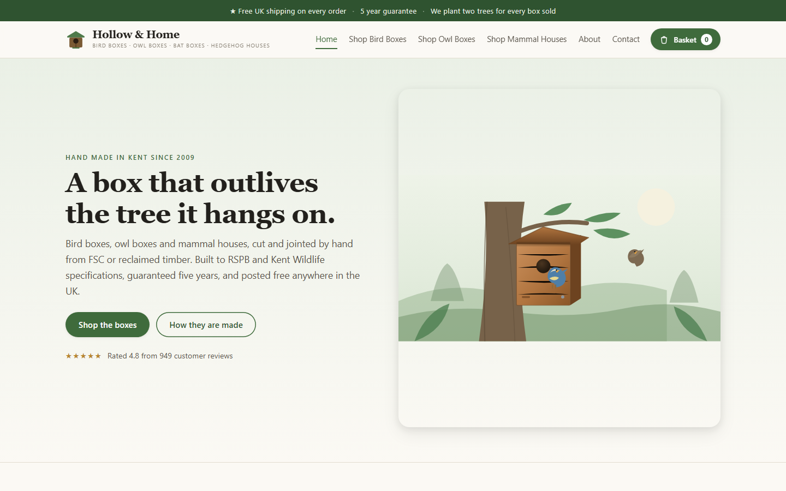
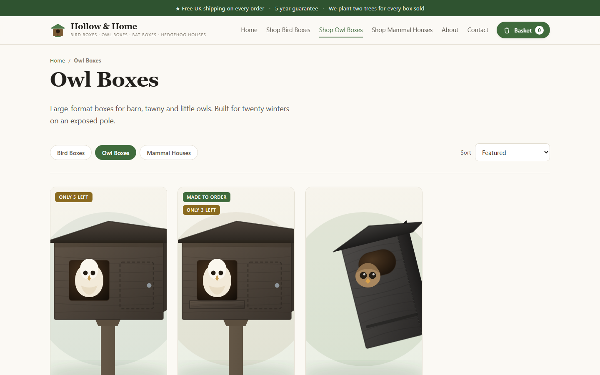
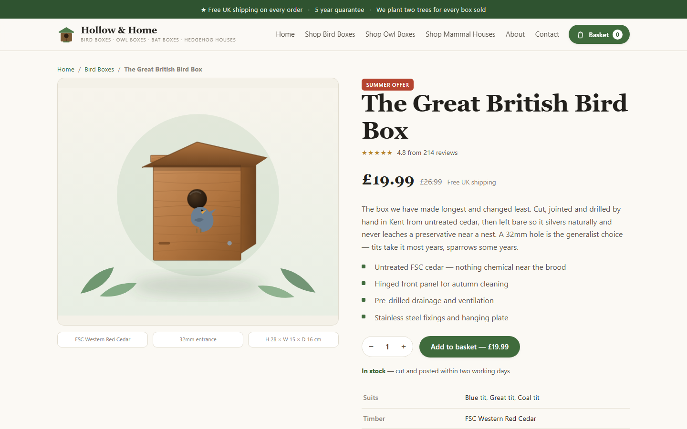
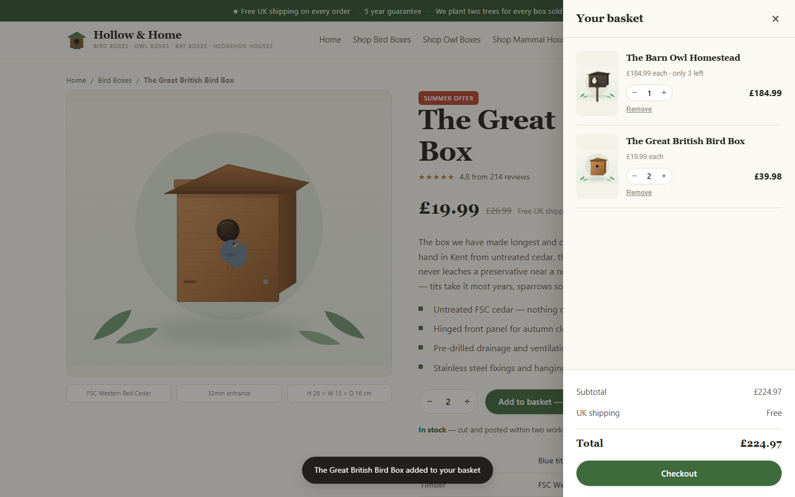
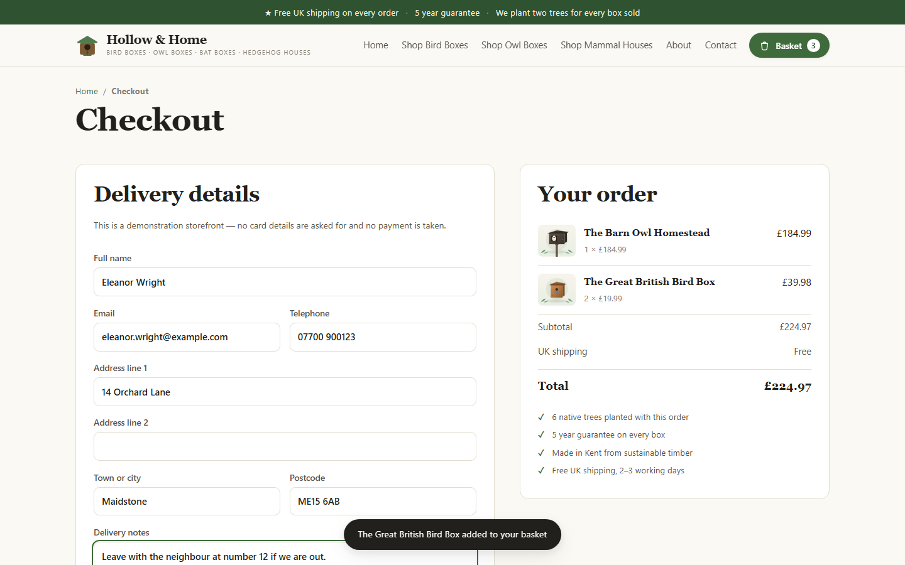
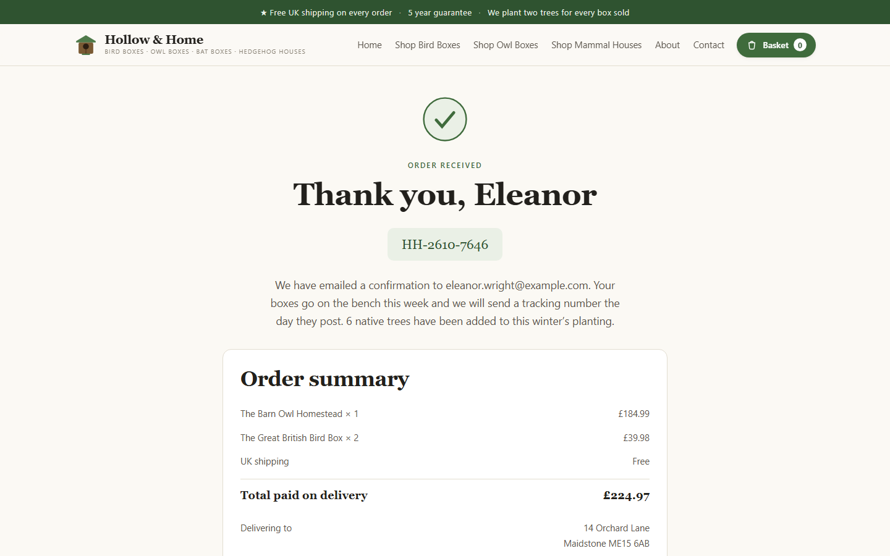
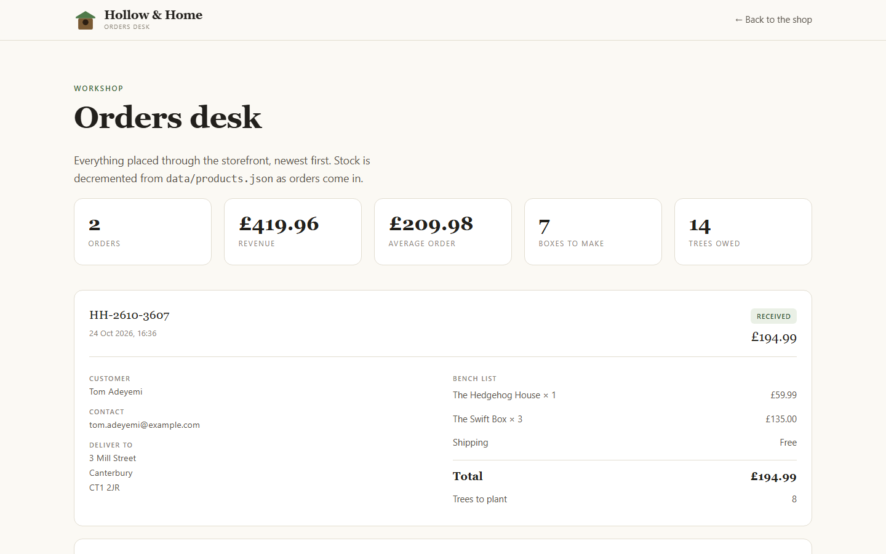
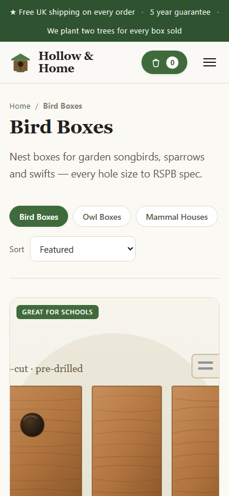
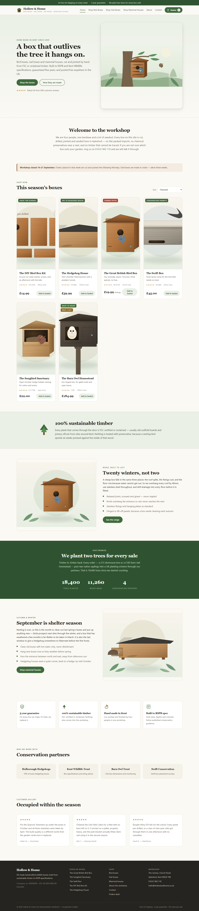

# Hollow & Home — birdbox storefront

I built Hollow & Home as a complete small e-commerce site for a fictional Kent workshop that makes bird boxes, owl boxes and mammal houses. The structure follows a real shop in this niche (three product families, sustainable-timber positioning, free shipping, a five-year guarantee, two trees planted per sale), but the brand, copy, catalogue and artwork are my own.

The whole thing runs on Node with no dependencies: one `server.js` that serves the static front end and a small JSON API, a hash-routed single-page storefront, a basket that survives reloads, a checkout that is priced and validated on the server, and an orders desk for the workshop. Even the thirteen product illustrations are generated by a script in the repo.



## What it does

- **Storefront** — hero, welcome, workshop notice, sortable "this season" product grid, sustainable-timber callout, "built to last" and seasonal sections, two-trees promise with counters, four trust promises, conservation partners, customer reviews and footer.
- **Shop** — three categories (bird / owl / mammal) with category chips and four sort orders.
- **Product pages** — story copy, feature list, full specification table (species, timber, entrance diameter, dimensions, guarantee, delivery), quantity stepper, live stock line and related products.
- **Basket** — slide-in drawer with quantity stepping, removal and running totals. Persists in `localStorage` across reloads and silently drops any product that has left the catalogue.
- **Checkout** — delivery form with validation and a sticky order summary showing the trees-planted count. Posts to `POST /api/orders`.
- **Orders desk** — `/admin.html` shows order count, revenue, average order value, boxes to make and trees owed, plus a bench list per order with the delivery address.
- **Static pages** — About and Contact (the contact form is front-end only).

There is no payment provider, no accounts and no email sending. The checkout says on the page that it is a demonstration flow and takes no card details.

## How it works

```
server.js              HTTP server, static files, order API, stock writeback
data/products.json     catalogue, brand details, promises, partners, live stock
data/orders.json       placed orders (starts as [])
public/index.html      storefront shell, all views
public/styles.css      design system
public/app.js          hash routing, basket, product pages, checkout
public/admin.html      orders desk
tools/make-images.js   generates the 13 SVG illustrations
```

**Routing.** The storefront is one HTML file. `app.js` switches between `view-*` sections based on `location.hash` (`#home`, `#shop/owl`, `#product/<id>`, `#checkout`, `#thanks`, `#about`, `#contact`). Unknown paths on the server fall back to `index.html` so a refresh on any route still works.

**API.**

| Route | Purpose |
|---|---|
| `GET /api/catalog` | Brand, categories, products, promises, partners |
| `GET /api/orders` | All orders, newest first, with count and revenue |
| `POST /api/orders` | Place an order — `{ customer, items: [{ id, qty }] }` |

**Server-side pricing.** The browser only ever sends product ids and quantities. The server looks up the real price in `data/products.json`, checks stock, computes the total, and refuses to oversell. Unknown products, insufficient stock or missing customer fields come back as `400`/`409` with a list of messages that the checkout renders inline. A successful order gets a reference like `HH-2610-7646`, is appended to `data/orders.json`, and the stock in `data/products.json` is decremented.

**Catalogue is read per request**, so editing prices or stock in `data/products.json` does not need a restart.

**Artwork.** `node tools/make-images.js` redraws every illustration into `public/img`. Each product maps to a drawing function in the `SPECS` table at the bottom of that file; swapping in photographs is just a matter of pointing a product's `img` at a `.jpg` instead.

## Stack

| Layer | Choice |
|---|---|
| Runtime | Node.js 18+ (`http`, `fs`, `path`, `crypto` only — no npm packages) |
| Front end | Vanilla HTML, CSS and JavaScript, hash routing |
| State | `localStorage` basket; JSON files on disk for catalogue and orders |
| Artwork | SVG generated by `tools/make-images.js` |

**Data.** Hollow & Home is a fictional brand. Its address, phone number (Ofcom's drama range), company and VAT numbers are placeholders, and the customers in the screenshots (for example Eleanor Wright and Tom Adeyemi at `example.com`) are invented test orders. `data/orders.json` ships empty.

## Run it locally

```bash
git clone https://github.com/ashhhadd-210/birdbox-shop.git
cd birdbox-shop
node server.js
```

| | |
|---|---|
| Storefront | http://localhost:4700 |
| Orders desk | http://localhost:4700/admin.html |

No `npm install` is needed. Override the port with `PORT=5000 node server.js`. On Windows, `start-shop.cmd` starts the server and opens the storefront in the browser.

No credentials or external services are required. Placing an order writes to `data/orders.json` and `data/products.json`; `git checkout data/` resets them.

### Editing it

- **Products, prices, stock** — `data/products.json`.
- **A new product** — add an object with a unique `id`, a `cat` of `bird`/`owl`/`mammal`, and an `img` path.
- **Artwork** — `npm run images` (or `node tools/make-images.js`).
- **Brand, phone, address** — the `brand` block in `data/products.json` plus the header and footer in `public/index.html`.
- **Currency** — `currency` in `data/products.json` and the `money()` helper in `public/app.js`.

## Screenshots

Shop page for the owl category, with category chips and sort control.



A product page: offer badge, rating, story, feature list, quantity stepper and the start of the specification table.



The basket drawer after adding two products, with the "added" toast.



Checkout with the delivery form filled in and the sticky order summary.



Order confirmation with the generated reference and the order summary.



The orders desk after two test orders.



The shop at phone width.



The full home page.



## Limitations

Orders are a JSON file, which is fine for one workshop and wrong for concurrent writes at scale; a real deployment would want a database and a payment provider.
